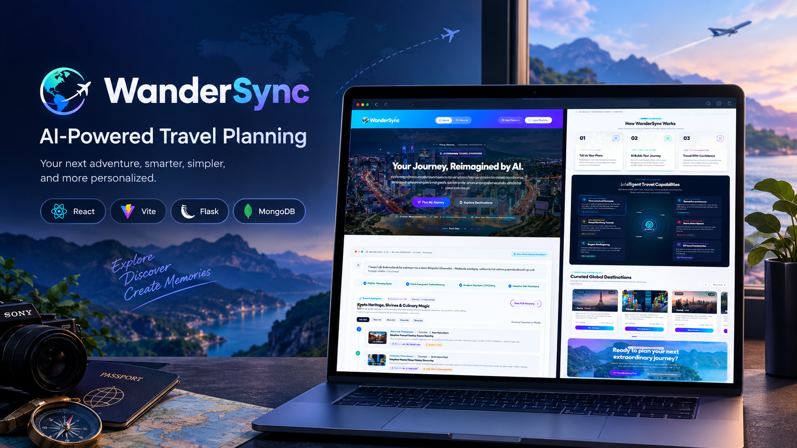
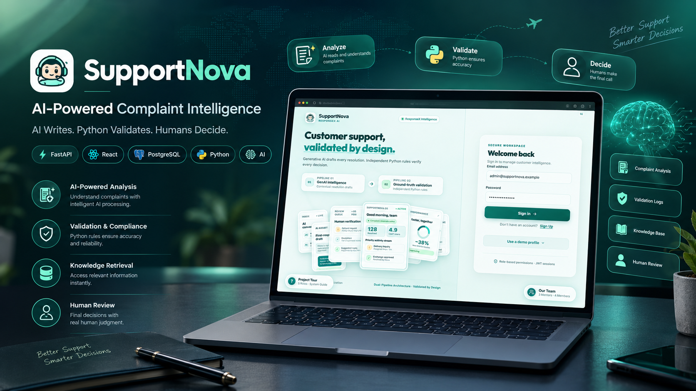

<!--
  ANOUSHA ZAMEER | GITHUB PROFILE
  Design: Midnight Navy · Electric Blue · Teal
  Keep image paths and project URLs updated.
-->

  <h1>Anousha Zameer</h1>

  <h3>Full-Stack Developer · AI Engineering Enthusiast</h3>

  

    <strong>Engineering useful software. Building reliable systems. Making AI more practical.</strong>
  

  

    
    
    
    
  

---

## About Me

I'm Anousha Zameer, a developer focused on full-stack applications, practical AI engineering, and dependable backend systems.

I enjoy turning ideas into usable products, designing maintainable architectures, and building AI-assisted workflows that combine intelligent generation with deterministic validation and human oversight.

My approach is simple: **build with purpose, engineer with care, and make every system easier to understand and trust.**

- **Focus:** Full-stack development, backend engineering, and applied AI
- **Interests:** API design, database systems, AI-assisted workflows, and software architecture
- **Engineering mindset:** Readable code, validated outputs, useful documentation, and measurable improvements
- **Currently building:** Practical applications that connect modern web technologies with intelligent automation

---

## 01 · Featured Engineering Projects

<table>
  <tr>
    <td width="42%" valign="middle" align="center">
      
    </td>
    <td width="58%" valign="middle">

### WanderSync

**AI-Assisted Travel Planning Platform**

A travel-planning application designed to help users explore destinations, organize itineraries, and make more informed travel decisions.

**Engineering highlights**
- Destination discovery and trip organization
- AI-assisted travel planning
- Personalized itinerary workflows
- Budget-aware planning features

**Technology**
`React` `Vite` `Flask` `MongoDB`

</td>
  </tr>
</table>

<table>
  <tr>
    <td width="42%" valign="middle" align="center">
      
    </td>
    <td width="58%" valign="middle">

### SupportNova

**AI-Powered Complaint Intelligence**

An AI-assisted complaint management system designed to combine generated complaint analysis with deterministic rule validation and structured human review.

**Engineering highlights**
- Structured AI-generated complaint intelligence
- Python-based business-rule validation
- Complaint review and escalation workflows
- Human oversight and consistency checks

**Technology**
`Python` `FastAPI` `React` `PostgreSQL`

</td>
  </tr>
</table>

---

## 02 · Technical Expertise

### Programming Languages

  
  
  
  
  
  

### Frontend Engineering

  
  
  
  
  
  
  
  
  
  

### Backend & API Development

  
  
  
  
  
  
  

### Databases & Cloud Infrastructure

  
  
  
  
  
  
  
  
  
  

### Data Science & Machine Learning

  
  
  
  
  
  

### Developer Tools

  
  
  
  

---

## 03 · GitHub Analytics

  
  

   

  

---

## 04 · Engineering Principles

<table>
  <tr>
    <td width="50%" valign="top">

**01 — Purposeful Engineering**

Build software around real user needs, not features without a purpose.

</td>
    <td width="50%" valign="top">

**02 — Reliable Systems**

Use clear logic, validation, and predictable behavior wherever possible.

</td>
  </tr>
  <tr>
    <td width="50%" valign="top">

**03 — Responsible AI**

Combine AI capabilities with validation, transparency, and appropriate human oversight.

</td>
    <td width="50%" valign="top">

**04 — Maintainable Code**

Favor readable implementations, useful documentation, and reusable components.

</td>
  </tr>
</table>

---

## 05 · What's Next

I’m continuing to strengthen my software engineering foundations, explore practical AI systems, and develop projects that demonstrate real technical problem-solving.

My goal is to build software that is not only functional, but also reliable, maintainable, and genuinely useful.

  
<strong>Ideas → Engineering → Impact</strong>

  

    Thanks for visiting my profile.
     
    Explore my repositories, review my work, and follow my engineering journey.
  

  

